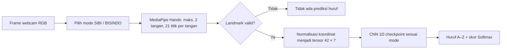

# Bahan presentasi: metode dan evaluasi AI SIBI–BISINDO

Status: 26 Oktober 2026. Dokumen ini menggambarkan **dua checkpoint yang dipilih untuk service produksi**, bukan seluruh eksperimen terdahulu. Angka performa di bawah berasal dari **validation dataset offline**; belum ada angka akurasi final pada peserta baru atau pengujian webcam terstruktur.

## Ringkasan satu slide

Sistem mengenali **satu huruf alfabet statis A–Z per frame webcam**, dengan mode SIBI atau BISINDO dipilih pengguna. MediaPipe Hands mengekstrak koordinat 21 landmark per tangan. Koordinat dinormalisasi menjadi tensor **42 titik × 7 kanal**, lalu diklasifikasikan dengan **CNN 1D kecil + Softmax**. Ada dua checkpoint terpisah: SIBI dilatih dari awal; encoder SIBI dipakai sebagai inisialisasi untuk melatih BISINDO dengan kepala klasifikasi baru. Pada validation offline, akurasi sistem SIBI **95,61%** (283/296) dan BISINDO **91,21%** (1.453/1.593). Kegagalan ekstraksi landmark dihitung sebagai gagal mengenali huruf dalam kedua angka tersebut.

## 1. Tujuan dan keluaran sistem

- Input: frame webcam berwarna; output: satu label huruf, skor model, jumlah tangan, status deteksi, dan landmark jika diminta.
- Mode bahasa dipilih pengguna. **Jumlah tangan tidak dipakai untuk menentukan bahasa otomatis**; sampel BISINDO dapat menghasilkan satu atau dua tangan terdeteksi.
- Fokus MVP adalah pose statis. **J/Z SIBI saat ini kandidat pose statis dari sumber ASL**, bukan pengenalan lintasan gerakan. Sistem belum menyusun kata atau kalimat.
- Dua model berjalan di service FastAPI yang sama melalui endpoint HTTP dan WebSocket. Halaman uji: <https://ai.signtech.tech/production.html>. [Kontrak API](API_CONTRACT.md).

## 2. Dataset yang dipakai checkpoint produksi

| Mode | Sumber training terpilih | Train | Validation | Landmark valid pada validation |
|---|---|---:|---:|---:|
| SIBI | Dataset [SIBIAlphabet Mendeley](https://data.mendeley.com/datasets/yhsgmynccf/1), 24 kelas A–I/K–Y; J/Z ditambah dari dataset landmark ASL `.npy` | 1.085 | 296 | 295 (99,66%) |
| BISINDO | Dataset [Indonesian Sign Language – BISINDO di Kaggle](https://www.kaggle.com/datasets/agungmrf/indonesian-sign-language-bisindo), A–Z | 8.341 | 1.593 | 1.537 (96,48%) setelah recovery v2 |

Pada SIBI, validation terdiri dari **216 gambar kelas asli SIBI + 40 J + 40 Z**; 1.077/1.085 train memiliki fitur valid. Pada BISINDO, 7.871/8.341 train memiliki fitur valid setelah recovery v2. Gambar yang gagal ekstraksi tetap berada dalam penyebut metrik sistem, tetapi tidak dipakai untuk melatih classifier. Dataset BISINDO Mendeley pernah diaudit, namun **bukan sumber checkpoint BISINDO produksi** ini. [Rincian sumber](DATASET_SOURCES.md), [manifest model SIBI](../models/selected-sibi-bisindo-v1/sibi/dataset.json), [manifest model BISINDO](../models/selected-sibi-bisindo-v1/bisindo/dataset.json).

Pembagian data memakai train/validation yang dikunci pada eksperimen. Identitas peserta tidak tersedia secara memadai untuk memastikan peserta train dan validation berbeda. Karena itu skor validation **tidak boleh disebut akurasi pada pengguna baru**. J/Z dari sumber ASL berbeda dari 24 huruf SIBI lain; perbedaan sumber dapat ikut memengaruhi skor J/Z. Test pada run checkpoint terpilih **tidak dibuka**. [Protokol evaluasi](EVALUATION_PROTOCOL.md), [rencana eksperimen koordinat](COORDINATE_RESET_PLAN.md).

## 3. Alur dan representasi fitur

MediaPipe menangani **deteksi tangan dan landmark**; CNN melakukan **klasifikasi huruf dari koordinat**. Piksel gambar tidak diberikan langsung kepada CNN. Frame inferensi tidak dicerminkan; hanya preview pengguna yang dapat dicerminkan. Data SIBI memakai ambang deteksi MediaPipe 0,5, BISINDO 0,3. Kedua jalur memakai maksimal dua tangan dan MediaPipe Hands versi 0.10.21. [Konfigurasi SIBI](../configs/landmarks_v1.json), [konfigurasi BISINDO](../configs/landmarks_bisindo_kaggle_v2_conf03.json).

Tensor `42 × 7` berarti dua slot tangan × 21 titik. Tujuh kanal per titik ialah `local_x`, `local_y`, `local_z`, posisi pergelangan relatif `wrist_x`/`wrist_y`, rasio skala telapak, dan penanda `present`. Koordinat lokal dihitung relatif ke pergelangan dan skala telapak; slot tangan diurutkan menurut posisi pergelangan pada gambar. Slot yang kosong menjadi nol dengan `present=0`. Ini mempertahankan bentuk dan hubungan posisi dua tangan sambil mengurangi pengaruh posisi absolut di frame. Bentuk tensor **bukan 42 frame waktu**: CNN 1D bekerja pada urutan titik landmark dalam satu frame, bukan urutan gerakan. [Implementasi tensor](../src/sibi_bisindo/coordinates.py).

Pada BISINDO, gambar yang gagal atau hanya menghasilkan satu tangan pada deteksi awal dapat dicoba lagi melalui beberapa rotasi, crop/ROI, perbaikan kontras, dan pembesaran. Koordinat dari view tambahan dipetakan kembali ke gambar asli lalu disaring dengan aturan geometri/duplikasi. Kebijakan recovery yang sama tersedia pada ekstraksi offline dan inferensi. Recovery meningkatkan **cakupan fitur**, tetapi tidak membuktikan setiap landmark benar secara anatomis. [Metode recovery v2](BISINDO_RECOVERY_TRAINING_V2.md).

## 4. Model dan training

| Komponen | Implementasi |
|---|---|
| Arsitektur | `Conv1D(7→32, kernel 3)` → ReLU → `Conv1D(32→64, kernel 3)` → ReLU → max pooling → dense embedding 64 → dropout 0,2 → dense 26 → Softmax saat prediksi |
| Ukuran | 94.682 parameter trainable per checkpoint 26 kelas, dihitung dari implementasi model |
| SIBI | CNN dilatih dari awal pada tensor SIBI + J/Z; bobot epoch **89** dipilih dari maksimal 100 epoch berdasarkan *validation system macro-F1* |
| BISINDO | Encoder CNN SIBI disalin, classifier 26 kelas baru; **10 epoch head** dengan encoder dibekukan, lalu **60 epoch fine-tuning** encoder + classifier; bobot terbaik epoch total **69** |
| Augmentasi training | Rotasi koordinat kecil (±12°) dan noise koordinat; tidak menerapkan flip otomatis atau menciptakan tangan yang hilang |
| Pemilihan model | Berdasarkan macro-F1 sistem pada validation; checkpoint SIBI dan BISINDO disimpan terpisah |

Pada eksperimen SIBI, CNN–Softmax dibandingkan dengan MLP–Softmax serta SVM linear/RBF pada embedding CNN/MLP. **CNN–Softmax terpilih**, bukan CNN–SVM: macro-F1 sistem validation 96,44%, sedikit di atas CNN–SVM RBF 96,32%. SVM tersebut adalah kandidat pembanding, **bukan model yang dideploy**. Pada BISINDO, sampling training dibuat seimbang per kelas; encoder SIBI merupakan inisialisasi, sedangkan checkpoint SIBI sendiri tidak ditimpa. Run ini belum membandingkan manfaat transfer terhadap model BISINDO yang dilatih dari nol. [Arsitektur](../src/sibi_bisindo/coordinate_model.py), [pemilihan SIBI](COORDINATE_RESET_SIBI_RUN01.md), [pemilihan BISINDO](BISINDO_RECOVERY_TRAINING_RUN01.md).

## 5. Evaluasi: apa yang dihitung

1. **Cakupan landmark:** banyak gambar yang menghasilkan fitur koordinat valid ÷ seluruh gambar. Ini mengukur apakah pipeline dapat memasok classifier, bukan akurasi huruf.
2. **Akurasi dan macro-F1 classifier pada fitur valid:** hanya gambar yang landmark-nya lolos. Macro-F1 merata-ratakan F1 setiap huruf sehingga kelas besar tidak otomatis mendominasi.
3. **Akurasi dan macro-F1 sistem pada seluruh gambar:** gambar tanpa fitur valid dihitung sebagai penolakan/gagal mengenali huruf. Ini angka utama untuk membandingkan pipeline offline secara keseluruhan.
4. **Analisis per huruf dan confusion matrix:** memperlihatkan huruf yang salah prediksi dan yang ditolak. Validasi ini masih berbasis gambar dataset, bukan trial webcam independen.
5. **Latensi:** waktu classifier diukur terpisah dari MediaPipe, recovery, jaringan, dan browser. Angka classifier **tidak sama dengan FPS sistem**.

| Metrik validation checkpoint terpilih | SIBI | BISINDO |
|---|---:|---:|
| Gambar validation | 296 | 1.593 |
| Fitur valid | 295/296 (**99,66%**) | 1.537/1.593 (**96,48%**) |
| Akurasi classifier pada fitur valid | **95,93%** | **94,53%** |
| Macro-F1 classifier pada fitur valid | **96,67%** | **94,38%** |
| Prediksi benar pada semua gambar | 283/296 | 1.453/1.593 |
| Akurasi sistem semua gambar | **95,61%** | **91,21%** |
| Macro-F1 sistem semua gambar | **96,44%** | **92,62%** |
| Median waktu classifier 1 sampel pada CPU saat evaluasi | 0,267 ms | 0,158 ms |

Angka dari [metrik SIBI](../artifacts/coordinate-reset-v1/sibi_20261020_130607_889055/cnn_softmax_validation.json) dan [metrik BISINDO](../artifacts/bisindo-transfer-recovery-v2/bisindo_20261021_133454_756637/cnn_softmax_validation.json). Waktu classifier diukur dalam lingkungan eksperimen yang berbeda; jangan memakainya sebagai perbandingan kecepatan ujung ke ujung kedua mode.

### Detail yang berguna untuk tanya jawab

- SIBI: pada 24 huruf sumber SIBI, 212/216 benar (98,15%) dalam validation. J 32/40 (80% recall), Z 39/40 (97,5% recall). Skor total 26 huruf dipengaruhi oleh tambahan J/Z lintas sumber. [Review SIBI](COORDINATE_RESET_SIBI_RUN01.md).
- BISINDO: recovery v2 menaikkan cakupan validation dari **1.401/1.593 (87,95%)** menjadi **1.537/1.593 (96,48%)**; akurasi sistem pada split yang sama naik dari **81,61%** menjadi **91,21%** dibanding run transfer sebelumnya. Perubahan ini menggabungkan perubahan fitur dan bobot model, bukan pengukuran dampak recovery secara terisolasi. [Review BISINDO](BISINDO_RECOVERY_TRAINING_RUN01.md).
- Huruf A BISINDO hanya benar 39/66 (59,09%) pada metrik sistem validation; 17 gagal ekstraksi dan 10 salah klasifikasi. D/F/P memiliki hasil validation yang cukup tinggi (D 52/54, F 57/59, P 63/67), tetapi pengguna melaporkan **D sulit dikenali pada webcam**. Ini menunjukkan perbedaan antara data validation dan pemakaian nyata; penyebabnya belum dipastikan.
- Uji integrasi browser produksi sudah berhasil untuk HTTP/WSS kedua model dan kamera sintetis. Gambar putih menghasilkan `no_hand` seperti yang diharapkan. **Itu menguji koneksi dan alur inferensi, bukan akurasi alfabet webcam.** Belum ada pengukuran trial webcam berlabel yang layak menjadi angka presentasi.

## 6. Visualisasi yang bisa dipakai di PPT

Gambar di bawah **sudah ada di workspace lokal**. Direktori `artifacts/` dan `data/` diabaikan Git, jadi kirim PNG-nya secara terpisah kepada pembuat PPT jika ia hanya menerima repository GitHub. Diagram Mermaid pada bagian 3 dapat dirender dari file Markdown ini atau digambar ulang sebagai bagan alur.

| Visual | Kegunaan slide | File lokal |
|---|---|---|
| Kurva loss dan macro-F1 SIBI | Menunjukkan perbandingan CNN vs MLP serta epoch terpilih | [learning_curves.png SIBI](../artifacts/coordinate-reset-v1/sibi_20261020_130607_889055/learning_curves.png) |
| Kurva loss dan macro-F1 BISINDO | Menunjukkan tahap head → fine-tuning dan epoch terbaik 69 | [learning_curves.png BISINDO](../artifacts/bisindo-transfer-recovery-v2/bisindo_20261021_133454_756637/learning_curves.png) |
| Grafik cakupan landmark BISINDO | Menunjukkan valid train 80,09%→94,37% dan validation 87,95%→96,48% | [overview.png](../data/reports/bisindo-recovery-v2/overview.png) |
| Heatmap fitur valid per huruf | Menunjukkan peningkatan yang berbeda antarhuruf, misalnya A dan Y | [per_letter.png](../data/reports/bisindo-recovery-v2/per_letter.png) |
| Confusion matrix sistem SIBI | Kesalahan antarhuruf dan satu gambar yang ditolak pada validation 26 kelas | [confusion_matrix_sibi_validation.png](../outputs/presentation/confusion_matrix_sibi_validation.png) |
| Confusion matrix sistem BISINDO | Kesalahan antarhuruf dan 56 gambar yang ditolak pada validation 26 kelas | [confusion_matrix_bisindo_validation.png](../outputs/presentation/confusion_matrix_bisindo_validation.png) |

Untuk slide hasil, tabel pada bagian 5 bisa diubah menjadi **dua kelompok batang per bahasa**: cakupan fitur, akurasi classifier valid, dan akurasi sistem. Beri label *validation offline* secara jelas; jangan menggabungkan kedua bahasa sebagai satu angka akurasi. Jangan gunakan grafik cakupan landmark sebagai grafik akurasi classifier.

Dua PNG confusion matrix dibuat dari matriks angka `system_all_images.confusion_matrix_with_reject_column` dalam JSON metrik checkpoint terpilih. Jalankan ulang `& '.\.venv-service\Scripts\python.exe' scripts/plot_selected_confusion_matrices.py` bila PNG belum ada di komputer pembuat PPT (memerlukan NumPy dan Matplotlib). Baris adalah huruf sebenarnya, kolom adalah keluaran model; warna menyatakan persentase per baris dan angka dalam sel menyatakan jumlah gambar. Kolom **Tolak** menghitung gambar yang gagal menghasilkan fitur landmark. Baris penolakan kosong pada JSON sumber tidak ditampilkan. PNG berada di `outputs/` yang diabaikan Git.

## 7. Batasan dan langkah berikutnya

- Belum ada evaluasi test yang segar dan benar-benar independen untuk kedua checkpoint terpilih; identitas pemeraga lintas split belum terverifikasi.
- J/Z SIBI menggunakan kandidat pose statis dari ASL dan belum memodelkan gerakan atau memverifikasi kesesuaian penuh dengan referensi SIBI.
- Recovery MediaPipe BISINDO membantu cakupan, tetapi dapat menambah latensi dan masih dapat menghasilkan landmark yang keliru. Prediksi D pada webcam masih bermasalah meskipun validation tinggi.
- Softmax adalah skor model **yang belum dikalibrasi sebagai probabilitas benar**. Tidak ada kelas `unknown/background`; pose di luar kelas dapat tetap diberi huruf bila landmark valid.
- Evaluasi berikutnya yang layak untuk klaim penggunaan nyata: kumpulkan trial webcam berlabel dari peserta baru, pisahkan peserta/sesi, ukur akurasi dan macro-F1 per trial, penolakan/false accept, serta latensi p50/p95 dan throughput ujung ke ujung. [Protokol yang sudah disiapkan](EVALUATION_PROTOCOL.md).

**Kalimat aman untuk presentasi:** “Pada validation gambar offline, pipeline koordinat landmark + CNN 1D mencapai akurasi sistem 95,61% untuk SIBI dan 91,21% untuk BISINDO. Sistem dua mode sudah berjalan melalui webcam dan API, tetapi performa pada pengguna baru masih perlu dievaluasi dengan trial webcam independen.”
